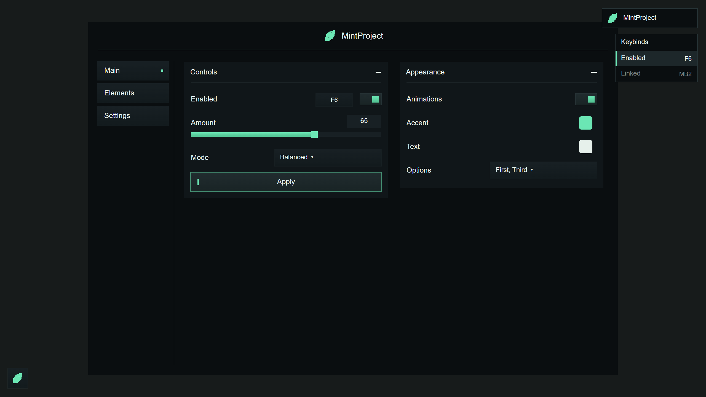
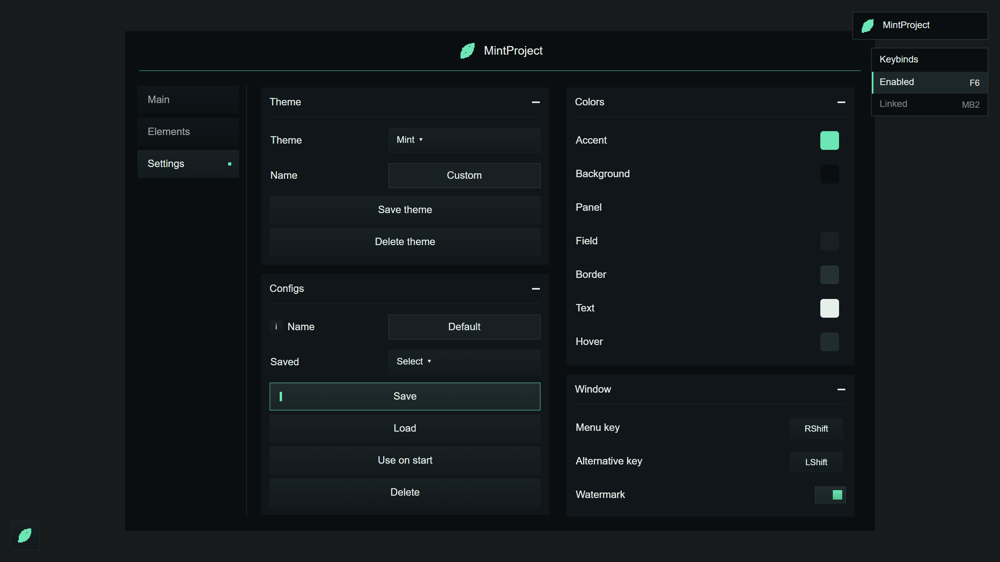
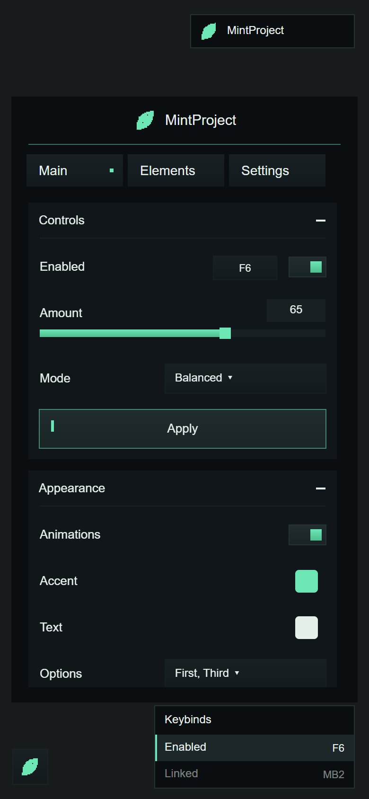

# MintProject

A compact Roblox UI library with a flat near-black palette, mint accents, square controls and column-based groups. Version **0.4.0**.

MintProject uses a standalone mint-leaf logo, centered branding, desktop side navigation and compact cards. Gradients are restricted to buttons and control fills. The library and managers are original implementations; the public API follows familiar Linoria-style naming. This is not a drop-in implementation of every Linoria feature.

## Quick demo

```lua
loadstring(game:HttpGet("https://raw.githubusercontent.com/amogamog70-afk/mintproject/main/Example.lua"))()
```

[Read the editable example](Example.lua): it starts by loading the library and managers, then defines the window, tabs, groups and controls directly below those links. The previous standalone [dist/Demo.lua](dist/Demo.lua) entry still works and contains everything in one download.

**Left Shift**, **Right Shift**, or the **leaf button** opens/closes the demo menu. Drag the title bar to move the window freely, including beyond the screen edges. Drag the leaf button to move it without opening/closing the menu. The Window settings provide two editable menu shortcuts.

Remote loading requires a client environment that provides `loadstring` and `game:HttpGet`. For standard Roblox LocalScripts, install the ModuleScripts instead.

## Your own interface

```lua
local repo = "https://raw.githubusercontent.com/amogamog70-afk/mintproject/main/"
local Library = loadstring(game:HttpGet(repo .. "Library.lua"))()
local ThemeManager = loadstring(game:HttpGet(repo .. "addons/ThemeManager.lua"))()
local SaveManager = loadstring(game:HttpGet(repo .. "addons/SaveManager.lua"))()

local Window = Library:CreateWindow({
    Title = "MintProject",
    Columns = 2,
    AutoShow = true,
})

local Tabs = {
    Main = Window:AddTab("Main"),
    Settings = Window:AddTab("Settings"),
}

local Main = Tabs.Main:AddLeftGroupbox("General")
Main:AddToggle("Enabled", {Text = "Enabled", Default = true})
    :AddKeyPicker("EnabledKey", {
        Default = "F6",
        Mode = "Toggle",
        SyncToggleState = true,
    })

Main:AddSlider("Amount", {
    Text = "Amount", Min = 0, Max = 100,
    Default = 65, Rounding = 0, Suffix = "%",
})

Main:AddDropdown("Mode", {
    Text = "Mode",
    Values = {"Balanced", "Detailed", "Minimal"},
    Default = "Balanced",
})

Library.Toggles.Enabled:OnChanged(function(value)
    print("Enabled:", value)
end)

ThemeManager:SetLibrary(Library)
ThemeManager:SetFolder("MintProject")
ThemeManager:ApplyToTab(Tabs.Settings)

SaveManager:SetLibrary(Library)
SaveManager:IgnoreThemeSettings()
SaveManager:SetFolder("MintProject")
SaveManager:BuildConfigSection(Tabs.Settings)
SaveManager:LoadAutoloadConfig()
```

## Layout and appearance

- Two columns by default, one on narrower screens. Optional three-column layouts use `Columns = 3` when content width permits. Groups move between columns without rebuilding controls.
- No font shrinking on phones. Touch controls have larger hit areas; tabs can scroll horizontally.
- Square opaque panels, thin borders, mint highlights and control-only gradients. Color swatches are the sole small rounded exception, filled entirely with their selected color and without a border.
- Header-only window dragging; draggable leaf launcher, watermark and keybind list. Pressing a drag handle never repositions the object. Viewport resizing does not undo a deliberate position.
- The whole menu, border and popup share one CanvasGroup with a 0.24-second fade. Toggle movement and color transitions take 0.32 seconds; interrupted transitions cancel cleanly.
- No close button or version/footer labels. Collapsed groups hide their divider; their plus/minus symbols use fixed geometry.
- Dropdown selections use highlighted rows with no checkbox or checkmark.
- Notifications outside the window, with a colored edge and fade-in/out.
- The mint leaf is rendered locally as native UI spans. It needs no image asset upload, file API or HTTP request. The editable vector is [assets/mint-logo.svg](assets/mint-logo.svg).
- No permanent render loop or scene scans. Input and layout changes are event-driven.

## Tabs and groups

```lua
local tab = Window:AddTab("Main")
local left = tab:AddLeftGroupbox("Left")
local middle = tab:AddGroupbox("Middle", {Column = 2})
local right = tab:AddGroupbox("Right", {Column = 3})
local second = tab:AddRightGroupbox("Second column")

left:SetExpanded(false)
tab:Select()
```

`Window.Tabs.Main` and `Window.Tabs[1]` both reference tabs. Collapsing a group preserves its values.

## Controls

| Method | Main options |
| --- | --- |
| `AddToggle(id, options)` | `Text`, boolean `Default`, `Callback` |
| `AddSlider(id, options)` | `Min`, `Max`, `Default`, `Step` or `Rounding`, `Suffix` |
| `AddRangeSlider(id, options)` | Same bounds, `Default = {lower, upper}` |
| `AddDropdown(id, options)` | `Values`, `Default` as name/index, `Multi` |
| `AddInput(id, options)` | `Default`, `Placeholder`, `Numeric`, `MaxLength` |
| `AddButton(options)` | `Text`, `Func` or `Callback`, optional `Primary` |
| `AddLabel(text)` | Label handle with `SetText`, `AddKeyPicker`, `AddColorPicker` |
| `AddDivider()` | Thin separator |

Use `Tooltip` or `Description` for a separate **i** help button.

Controls expose `Value`, `Get()`, `Set(value, silent?)`, `SetValue(value)` and `OnChanged(callback)`. Values only enter profiles when they have a unique ID. Toggles are in `Library.Toggles`; other controls are in `Library.Options`. These registries are local to the library, not injected as globals.

Defaults do not invoke callbacks. A bad application callback is reported without stopping the interface.

### Dropdowns

Long lists have search. Multiselects have select all and clear; their values are ordered arrays of names. `SetValue` also accepts a map such as `{Alpha = true, Beta = true}`. `dropdown:SetValues(newValues)` updates the available list.

### Sliders

`Step = 0` gives a smooth value. `Rounding = 2` gives two decimal places. Clicking the displayed number permits direct input. Values are validated, clamped and rounded. Range sliders expose two handles and two number fields.

### Keybinds and colors

```lua
Main:AddToggle("Feature", {Text = "Feature"})
    :AddKeyPicker("FeatureKey", {
        Default = "MB2", -- keyboard names, MB1 or MB2
        Mode = "Hold", -- Toggle, Hold or Always
        SyncToggleState = true,
        Callback = function(active) print(active) end,
    })

Main:AddLabel("Accent"):AddColorPicker("Accent", {
    Default = Color3.fromRGB(116, 227, 174),
    Callback = function(color) Library:SetTheme({Accent = color}) end,
})
```

Escape clears a captured key. Key actions do not fire while typing in a textbox. Color popups include an HSV square, hue strip and HEX input.

Right-click a feature keybind to choose **Hold**, **Toggle**, or **Always**. These modes apply to UI callbacks supplied by your application; the UI library itself implements no gameplay features. A keybind linked with `SyncToggleState = true` updates the associated toggle, and changes made using that toggle update its keybind-list indicator. Hold bindings release when the Roblox window loses focus.

```lua
local binding = Main:AddToggle("Example", {Text = "Example"})
    :AddKeyPicker("ExampleKey", {
        Default = "F8", Mode = "Hold", SyncToggleState = true,
    })
binding:SetMode("Always")
print(binding:GetState())
```

Use `HideFromList = true` to omit a binding from the overlay, or `NoModes = true` for plain menu shortcuts that should not offer activation modes. Configs retain both the assigned key and its mode; older key-only configs are still accepted.

The separate watermark and keybind list remain available when the menu closes. Each row contains only the function name and its key; active functions are highlighted. Both overlays can be dragged. On phones, the initial keybind list sits below the menu.

```lua
Window:SetWatermark("MintProject") -- text or boolean visibility
Window:SetKeybindsVisible(true)
```

## Theme manager

Five built-in palettes: Mint, Ice, Amber, Rose and Violet. The editor exposes the seven active color roles. Custom palettes can be saved, selected and deleted. Every label, input, placeholder and popup follows the single `Text` color; secondary text uses reduced opacity.

```lua
ThemeManager:ApplyTheme("Ice")
ThemeManager:SaveCustomTheme("My palette")
ThemeManager:DeleteCustomTheme("My palette")

Library:SetTheme({
    Accent = Color3.fromRGB(116, 227, 174),
    Background = Color3.fromRGB(10, 12, 12),
})
```

Active theme roles: `Background`, `Panel`, `Field`, `Border`, `Text`, `Accent`, `Hover`. Legacy `Muted`, `AccentText` and `White` keys remain accepted for compatibility; text colors are unified under `Text`.

## Config manager

Supports save, load, delete, refresh, ignored IDs and a selected autoload profile.

```lua
SaveManager:SetIgnoreIndexes({"TemporaryValue"})
SaveManager:Save("Default")
SaveManager:Load("Default")
SaveManager:SetAutoloadConfig("Default")
SaveManager:LoadAutoloadConfig()
SaveManager:Delete("Default")

local json = Library:ExportConfig()
local ok, errors = Library:ImportConfig(json)
```

Local persistence uses the environment's file APIs if available. Writes are verified by reading back the saved data. Without file APIs, managers use session memory; the Name field's info button reports the storage mode. Themes live in `MintProject/themes`, configs in `MintProject/configs`. Names are validated; paths cannot escape the selected folder.

In standard Roblox, session memory and JSON export/import work; persistent player profiles need an application-side server/DataStore integration. Import ignores unknown IDs, reports rejected values and applies valid controls.

## Window and lifecycle

```lua
Window:SetVisible(false)
Window:SetAnimations(true)
Window:SetToggleKey(Enum.KeyCode.Insert)
Window:SetToggleKey({Enum.KeyCode.LeftShift, Enum.KeyCode.RightShift})
Library:Notify("Ready", 3)
Window:Destroy()
Library:Unload() -- destroys every window and its listeners
```

The original `Tab`, `Section`, `Toggle`, `Slider`, `Dropdown`, `Textbox`, `ColorPicker` and `Keybind` methods remain available. Custom components can be registered with `Library:RegisterComponent(name, builder)`.

## Studio installation

Sync `default.project.json` with Rojo and run its included LocalScript. Or create a ModuleScript named `MintProject` in ReplicatedStorage using `src/init.luau`, add all other `src/*.luau` as children and require it from a LocalScript:

```lua
local Library = require(game:GetService("ReplicatedStorage"):WaitForChild("MintProject"))
local Window = Library:CreateWindow({Title = "MintProject"})
Window:AddTab("Main"):AddLeftGroupbox("General"):AddToggle("Enabled", {Text = "Enabled"})
```

Managers are also available as `Library.ThemeManager` and `Library.SaveManager`, without remote loading.

## Build and validation

```text
node scripts/logo.mjs
node scripts/build.mjs
lune run tests/smoke.luau
```

Editable source is in `src/`. `Library.lua`, `Example.lua`, `addons/` and `dist/` are generated; edit the source and rebuild.

Headless tests compile the code, validate native Roblox property types, simulate input, exercise config files and autoload using a mock filesystem, and check popup/lifecycle cleanup. Regressions cover GUI-inset dragging, offscreen movement, processed Shift input, launcher drag-versus-click, mode selection, Hold release, config mode roundtrips, collapsed dividers and whole-menu fading. The test loader maps Roblox's KeyCode.Unknown name to Lune's internal alias.

The layout previews below are rendered from the UI instance tree in a browser. They are layout approximations, **not screenshots from Roblox**. Version 0.4 passes the headless suite; final visual, touch and timing verification in a connected Roblox client is pending.





API naming reference: [LinoriaLib](https://github.com/violin-suzutsuki/LinoriaLib). No Linoria source is bundled and there is no runtime dependency on it.
